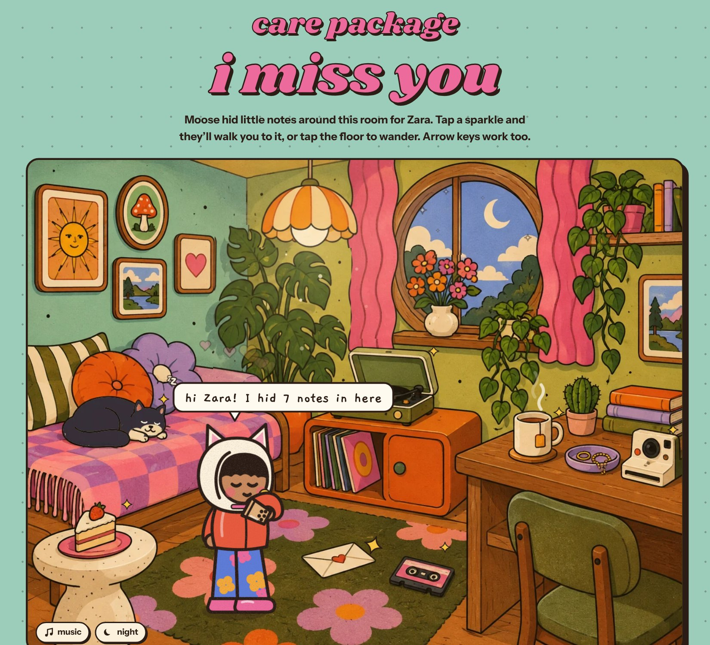
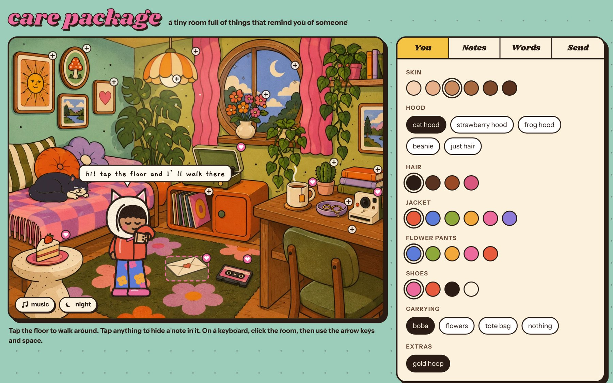
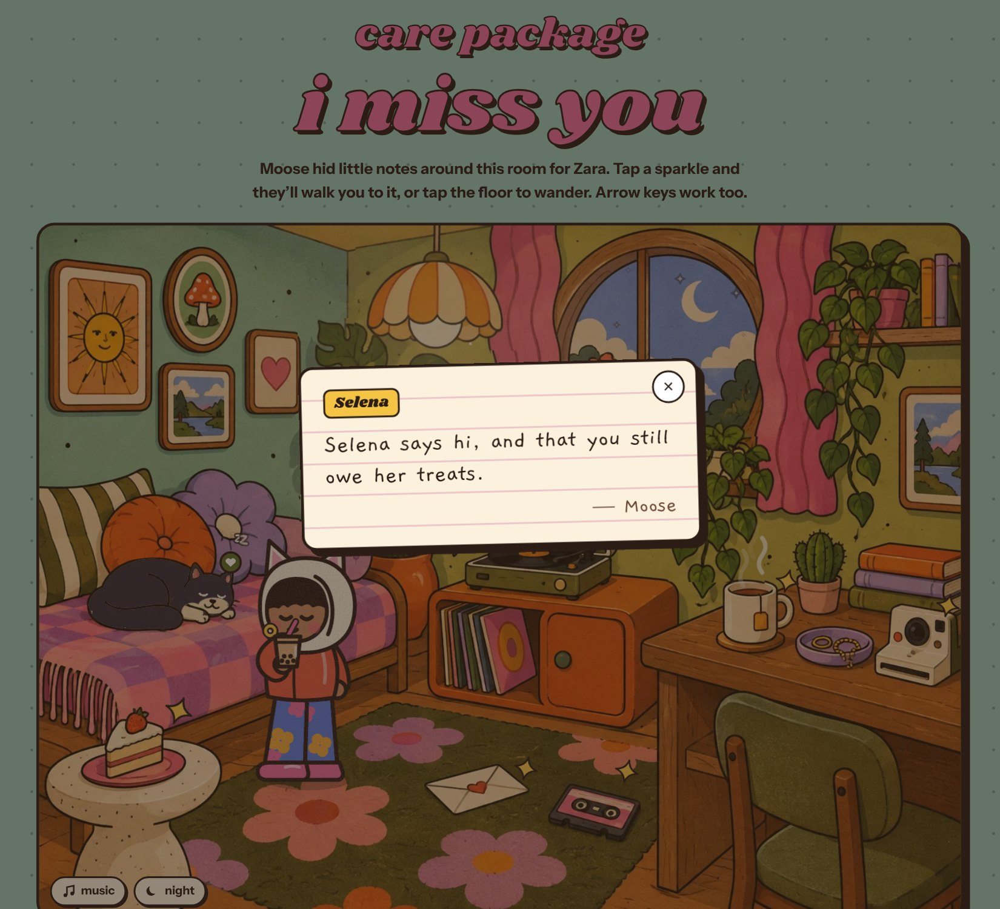

# care package

A tiny illustrated room you fill with notes for someone you miss.

You build the room: dress your avatar, tuck notes into things (the letter, the chai, the record player, Selena the cat…), pick the big words at the top and add a song. Then you send a link. Your friend opens an envelope, and your avatar walks them around the room to each note.

**Live:** https://namoos99.github.io/care-package/

## Making one

Dress your avatar, tap anything in the room to hide a note in it, then make the link.

## Opening one

Your friend taps a sparkle, your avatar walks over, and the note pops open.

## What's in it

- A walking avatar in a chunky, hand-drawn style: tap the floor (or use the arrow keys) and she walks there, swinging her arms; she waves when she reaches something. Pick a cat, strawberry or frog hood, colors, and what she's carrying.
- A room that moves on its own: swaying lamp, curtains and plants, steam from the chai, a breathing cat with floating z's, twinkling stars, dust in the lamplight.
- Night mode, and a record player that plays your Spotify song (or a built-in lo-fi tune).
- Greetings in English, Urdu, Hindi, Farsi, Arabic and Spanish.

## How the links work

There is no database and no account. The whole package (names, notes, avatar, song) is compressed into the part of the link after the `#`. Nothing is stored on a server, and the notes never end up in this repo.

## Run it

It's one self-contained file: open `index.html` in a browser. The site publishes to GitHub Pages through `.github/workflows/pages.yml` on every push to `main` (Settings → Pages → Source: GitHub Actions).

## Credits

Room illustration generated with Figma AI and hand-edited (Selena became a tuxedo cat). Avatar, motion, music and everything else are hand-written SVG, CSS and JavaScript. Inspired by Prasiddhi Jain's [care package](https://carepackage.prasjain.com).
